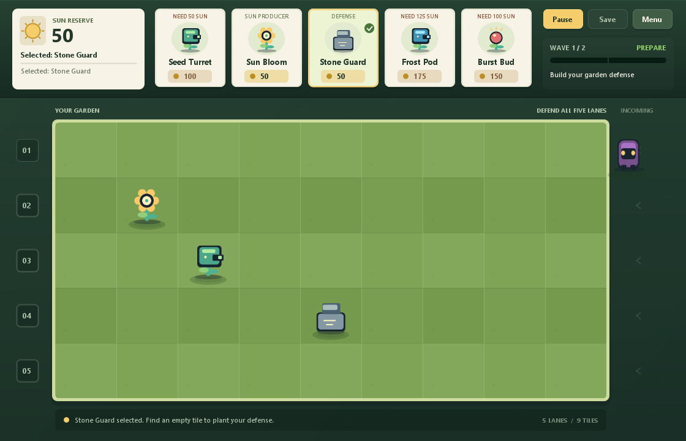
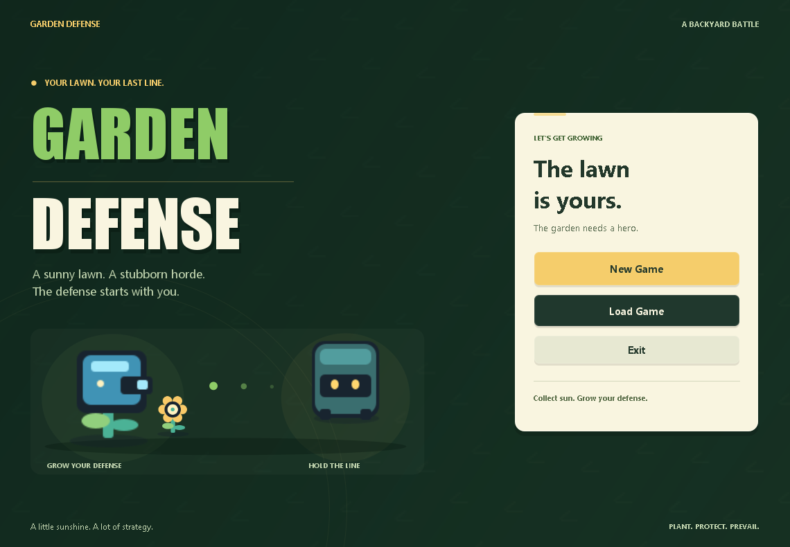

# Garden Defense — Java Swing

Java Swing ile geliştirilmiş küçük bir kule savunma oyunu. Amaç, 5×9’luk alana bitki yerleştirip güneş toplayarak zombilerin eve ulaşmasını engellemek.



## Oynanış

Atıcılar, güneş üreten çiçek, taş engel ve patlayan tomurcuk dahil beş savunma seçeneği var. Zombilerin hızları ve canları farklı olduğu için hangi bitkiyi nereye ve ne zaman yerleştirdiğin önemli.

- Giderek zorlaşan iki zombi dalgası
- Güneş toplama ve bitki maliyetleri
- Duraklatma, devam etme, kaydetme ve yükleme
- Ana menü, bitki seçim paneli ve oyun sonu ekranları



## Oyunu çalıştırma

Java 21 gerekiyor. Derlemek ve çalıştırmak için proje klasöründe PowerShell’i açıp şu komutları çalıştır.

```powershell
New-Item -ItemType Directory -Path build -Force | Out-Null
$sources = (Get-ChildItem src/pvz -Filter *.java).FullName
javac -encoding UTF-8 -d build $sources
java -cp build pvz.Main
```

## Kontroller

1. Ana menüden **New Game**’i seç.
2. Bir bitki kartına, ardından bitkiyi yerleştirmek istediğin boş kareye tıkla.
3. Düşen veya bitkilerin ürettiği güneşlere tıklayarak onları topla.
4. Oyunu duraklatmak ve sürdürmek için **Pause / Resume** düğmelerini kullan.

Oyun duraklatılmışken kaydedebilirsin. Kayıt `saves/savegame.txt` dosyasına yazılır. Kaldığın yerden devam etmek için ana menüden **Load Game**’i seç.

## Kodun yapısı

Kaynak kod `src/pvz/` klasöründe. Başlıca sınıflar ve görevleri şöyle.

- `GameEngine` oyun döngüsünü, saldırıları, kaynakları ve oyun durumunu yönetir.
- `Board`, `Plant` ve `Zombie` oyun tahtasını ve üzerindeki varlıkları temsil eder.
- `WaveSpawner` zombilerin çıkış zamanlarını belirler.
- `SaveLoadManager` kayıt dosyasını okur ve yazar.
- `GamePanel` ve `PlantSelectionPanel` Swing arayüzünü oluşturur.

Bu küçük masaüstü projesinde iki sabit dalga ve hareketsiz karakter görselleri var. Kürek özelliği projenin kapsamı dışında. Ayrıntılar için [proje raporuna](PROJECT_REPORT.md) bakabilirsin.

## Görseller

Oyun grafikleri Java 2D ile `src/pvz/GardenArt.java` içinde çiziliyor.
